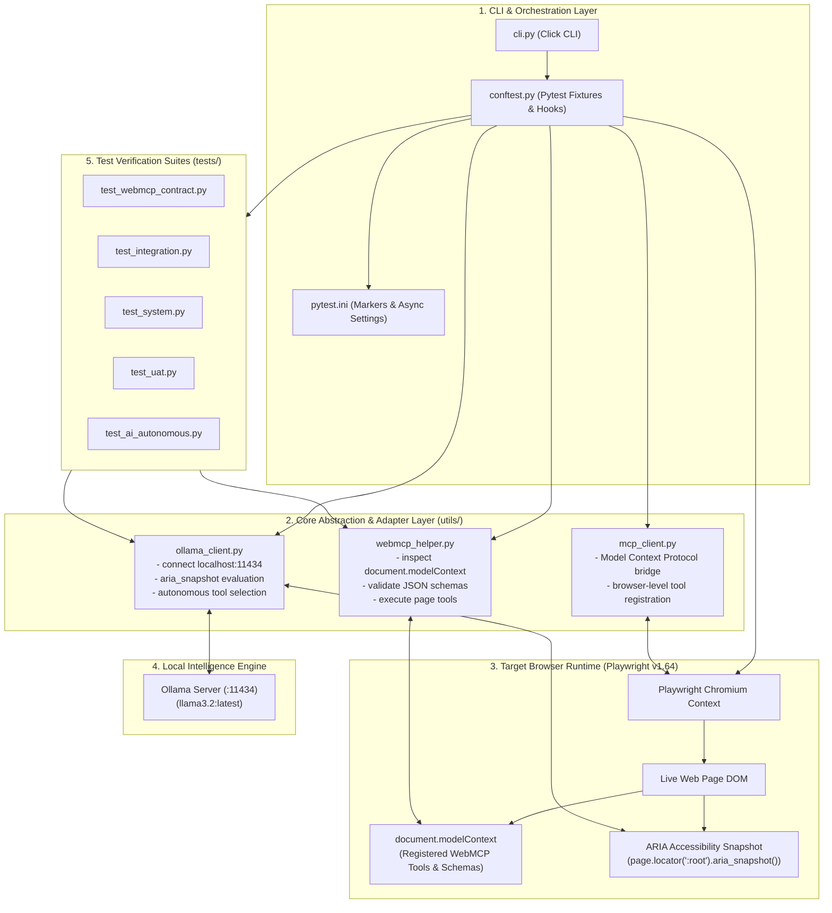
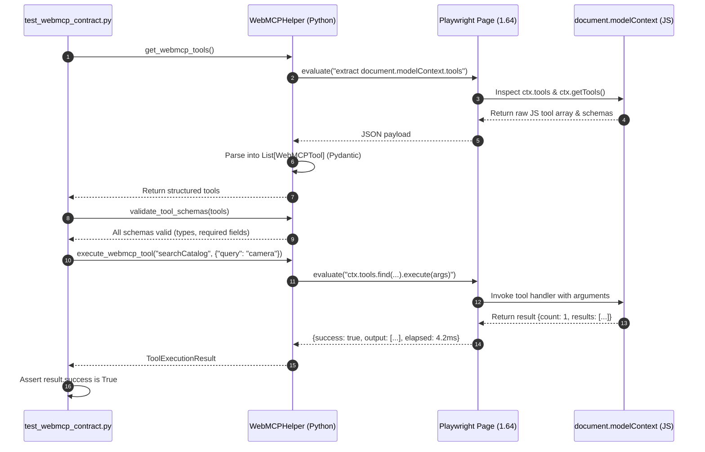
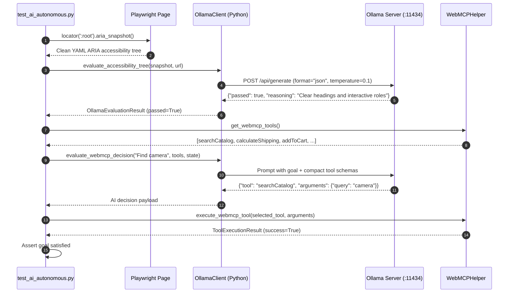

# 🧠 Architectural Blueprint & Master Onboarding Guide: `playwrightWEBMCP`

Welcome to the **AI Autonomous & Playwright v1.64 WebMCP E2E Testing Framework** codebase. This guide is engineered to help you systematically understand the architecture, trace data lifecycles from the command line down to DOM JavaScript contexts, debug effectively, and safely contribute new features.

---

## 📌 Project Context Sheet

| Attribute | Specification |
| :--- | :--- |
| **Domain / Project Type** | AI-Driven Autonomous & End-to-End (E2E) Browser Testing Framework |
| **Primary Capabilities** | WebMCP (`document.modelContext`) inspection, Local Ollama LLM integration, Multi-tier Pytest automation, CLI test orchestration |
| **Core Tech Stack** | Python 3.13, Playwright v1.64.0 (Chromium), Pytest 9 + `pytest-asyncio`, Ollama REST API (`llama3.2:latest`), Click 8.5, Pydantic v2, Rich |
| **Architectural Style** | Layered Architecture + Adapter/Bridge Pattern + Autonomous Agentic Loop |
| **Current Codebase State** | Production-grade, modular, fully typed with Pydantic models, 100% test pass rate across 5 tiers |

---

## 🏛️ Phase 1: High-Level Architectural Overview

### 1.1 System Topology Diagram

The framework bridges three distinct runtime environments: **The CLI/Pytest Test Engine (Python)**, **The Browser Execution Context (Playwright & DOM JavaScript)**, and **The Local AI Inference Engine (Ollama)**.



### 1.2 Directory & File Manifest

- [`cli.py`](file:///e:/AI_PORTABLE/PROJECTS/WebMCP/ai-playwright-webmcp-framework/cli.py): Main terminal entry point. Parses CLI flags (`--url`, `--tier`, `--model`, `--headed`, `--report`), configures pytest options, and outputs formatted Rich tables.
- [`conftest.py`](file:///e:/AI_PORTABLE/PROJECTS/WebMCP/ai-playwright-webmcp-framework/conftest.py): Pytest dependency injection hub. Supplies `browser_context`, `page`, `webmcp`, `ollama_client`, and `target_url` fixtures.
- [`pytest.ini`](file:///e:/AI_PORTABLE/PROJECTS/WebMCP/ai-playwright-webmcp-framework/pytest.ini): Declares test markers (`webmcp`, `integration`, `system`, `uat`, `autonomous`) and forces `asyncio_mode = auto`.
- [`utils/webmcp_helper.py`](file:///e:/AI_PORTABLE/PROJECTS/WebMCP/ai-playwright-webmcp-framework/utils/webmcp_helper.py): Core interface for discovering, schema-auditing, and executing tools on `document.modelContext`.
- [`utils/ollama_client.py`](file:///e:/AI_PORTABLE/PROJECTS/WebMCP/ai-playwright-webmcp-framework/utils/ollama_client.py): HTTP client interfacing with Ollama. Enforces deterministic JSON outputs for accessibility audits and agent decisions.
- [`utils/mcp_client.py`](file:///e:/AI_PORTABLE/PROJECTS/WebMCP/ai-playwright-webmcp-framework/utils/mcp_client.py): Bridge adhering to Model Context Protocol standards over Playwright contexts.
- [`demo/demo_app.html`](file:///e:/AI_PORTABLE/PROJECTS/WebMCP/ai-playwright-webmcp-framework/demo/demo_app.html): Standalone offline target web app featuring a full `document.modelContext` implementation with 5 sample tools.
- [`tests/`](file:///e:/AI_PORTABLE/PROJECTS/WebMCP/ai-playwright-webmcp-framework/tests): 5-tier test suites containing 21 automated assertions.

> 💡 **Guiding Question for You**:  
> Inspect [`utils/webmcp_helper.py`](file:///e:/AI_PORTABLE/PROJECTS/WebMCP/ai-playwright-webmcp-framework/utils/webmcp_helper.py#L30-L50). Notice how `is_supported()` evaluates JavaScript inside the browser context using `page.evaluate()`. What potential issue would arise if `document.modelContext` is populated asynchronously via a late script tag, and how does Playwright mitigate that?

---

## ⚙️ Phase 2: Environment & Execution Setup

### 2.1 Dependencies & Prerequisites
1. **Python 3.10+** (Tested on Python 3.13)
2. **Playwright 1.64.0**:
   ```bash
   pip install -r requirements.txt
   playwright install chromium
   ```
3. **Local Ollama Daemon**:
   Ensure Ollama is running at `http://localhost:11434` and the default model is pulled:
   ```bash
   ollama pull llama3.2:latest
   ```

### 2.2 CLI Execution Commands
The framework is executed via [`cli.py`](file:///e:/AI_PORTABLE/PROJECTS/WebMCP/ai-playwright-webmcp-framework/cli.py):

```bash
# 1. Run all 21 tests against default offline demo with HTML report
python cli.py --tier all --report

# 2. Run only WebMCP Contract tests against ANY external URL
python cli.py --url "https://news.ycombinator.com" --tier webmcp

# 3. Run AI Autonomous tests using local Ollama model
python cli.py --tier autonomous --model "llama3.2:latest"

# 4. Run System tests with visible browser UI (headed)
python cli.py --tier system --headed
```

### 2.3 Configuration Variables (`.env`)
Configured in [`.env.example`](file:///e:/AI_PORTABLE/PROJECTS/WebMCP/ai-playwright-webmcp-framework/.env.example):
- `TARGET_URL`: Default target when `--url` is omitted.
- `OLLAMA_BASE_URL`: Ollama endpoint (default `http://localhost:11434`).
- `DEFAULT_OLLAMA_MODEL`: Default model (e.g., `llama3.2:latest` or `qwen2.5:latest`).
- `OLLAMA_TIMEOUT`: Generation timeout in seconds (default `90`).

---

## 🔄 Phase 3: Data Flow & Lifecycle Tracing

### 3.1 Lifecycle A: WebMCP Tool Discovery & Execution

How a test discovers and invokes a tool exposed by a website:



### 3.2 Lifecycle B: Autonomous AI Navigation & Heuristic Assertion

How Ollama inspects the page state and autonomously decides what action to execute:



---

## 🛡️ Phase 4: Testing & Safety Nets

### 4.1 Test Tier Matrix

| Tier Marker | File | What it Validates | Graceful Fallback Strategy |
| :--- | :--- | :--- | :--- |
| `@pytest.mark.webmcp` | [`test_webmcp_contract.py`](file:///e:/AI_PORTABLE/PROJECTS/WebMCP/ai-playwright-webmcp-framework/tests/test_webmcp_contract.py) | `document.modelContext` presence, metadata format, tool schema conformance, and execution contract. | **`pytest.skip()`**: If target URL does not implement WebMCP, all contract tests skip gracefully with exit code 0. |
| `@pytest.mark.integration` | [`test_integration.py`](file:///e:/AI_PORTABLE/PROJECTS/WebMCP/ai-playwright-webmcp-framework/tests/test_integration.py) | Network response status codes (zero 5xx errors), static asset integrity, client fetch capability, console error boundaries. | Asserts standard browser network behaviors on any web page. |
| `@pytest.mark.system` | [`test_system.py`](file:///e:/AI_PORTABLE/PROJECTS/WebMCP/ai-playwright-webmcp-framework/tests/test_system.py) | Multi-step user interactions: input filling, button clicking, dynamic DOM status updates, and form submissions. | Adapts to custom controls or standard HTML forms. |
| `@pytest.mark.uat` | [`test_uat.py`](file:///e:/AI_PORTABLE/PROJECTS/WebMCP/ai-playwright-webmcp-framework/tests/test_uat.py) | Responsive mobile viewports (375x667 vs desktop), H1 heading hierarchy, user journeys, navigation performance SLA (<10s). | Validates universal WCAG and performance heuristics. |
| `@pytest.mark.autonomous` | [`test_ai_autonomous.py`](file:///e:/AI_PORTABLE/PROJECTS/WebMCP/ai-playwright-webmcp-framework/tests/test_ai_autonomous.py) | Local Ollama health, YAML ARIA accessibility audits, autonomous tool selection and execution, semantic smart assertions. | Skips gracefully if Ollama daemon is offline (`is_healthy() == False`). |

---

## 🔧 Phase 5: Safe Maintenance & Extension Strategy

### 5.1 How to Add a New WebMCP Tool (in Target Web Application)
When adding a new tool to `document.modelContext`, follow the 3-step contract:

```javascript
// Step 1: Define executable handler
async function checkInventoryTool({ sku }) {
  const item = INVENTORY.find(i => i.sku === sku);
  return { sku, inStock: !!item, quantity: item ? item.qty : 0 };
}

// Step 2: Register in document.modelContext.tools
document.modelContext.tools.push({
  name: "checkInventory",
  description: "Check available stock units for a specific item SKU",
  inputSchema: {
    type: "object",
    properties: {
      sku: { type: "string", description: "Product SKU identifier" }
    },
    required: ["sku"]
  },
  execute: checkInventoryTool
});
```

### 5.2 How to Add a New Test Tier to the Framework
1. Register the new marker in [`pytest.ini`](file:///e:/AI_PORTABLE/PROJECTS/WebMCP/ai-playwright-webmcp-framework/pytest.ini#L8):
   ```ini
   markers =
       security: Security, header inspection, and vulnerability checks
   ```
2. Map the tier in [`cli.py`](file:///e:/AI_PORTABLE/PROJECTS/WebMCP/ai-playwright-webmcp-framework/cli.py#L20):
   ```python
   TIER_MARKER_MAP["security"] = "-m security"
   ```
3. Create `tests/test_security.py` using standard fixtures (`page`, `target_url`, `webmcp`).

### 5.3 Key Architectural Gotchas & Troubleshooting

1. **Modern Playwright ARIA Snapshots vs Deprecated Accessibility Tree**:
   - *Problem*: Playwright deprecated `page.accessibility.snapshot()`.
   - *Solution*: Always use `page.locator(":root").aria_snapshot()`. It outputs clean YAML that consumes fewer LLM tokens.
2. **Windows Console Character Encoding**:
   - *Problem*: Windows `cp1252` encoding throws `UnicodeEncodeError` when printing emojis.
   - *Solution*: Reconfigure standard output streams to UTF-8 on Windows (`sys.stdout.reconfigure(encoding="utf-8")`) and use ASCII status badges like `[PASS]`, `[FAIL]`.
3. **Conflicting Option Strings in Pytest Plugins**:
   - *Problem*: `pytest-playwright` already registers `--headed`. Calling `parser.addoption("--headed")` causes `argparse.ArgumentError`.
   - *Solution*: Catch exceptions in `pytest_addoption` or rely on the plugin's built-in options.
4. **Local LLM Timeouts**:
   - *Problem*: Ollama models on CPU may take 30–60s when complex system prompts are sent.
   - *Solution*: Compact tool schemas, set low temperature (`0.1`), enforce `format: "json"`, and configure `OLLAMA_TIMEOUT=90`.

---

## 🎯 Verification Checklist for Contributors

Before committing changes to GitHub:
- [ ] Run `python cli.py --tier webmcp` (All 5 contract tests must pass).
- [ ] Run `python cli.py --url "https://example.com" --tier webmcp` (Must skip gracefully).
- [ ] Run `python cli.py --tier autonomous --model "llama3.2:latest"` (AI heuristics must pass).
- [ ] Run `python cli.py --tier all --report` (21/21 tests must pass, `report.html` generated).
- [ ] Confirm `git status` is clean.
