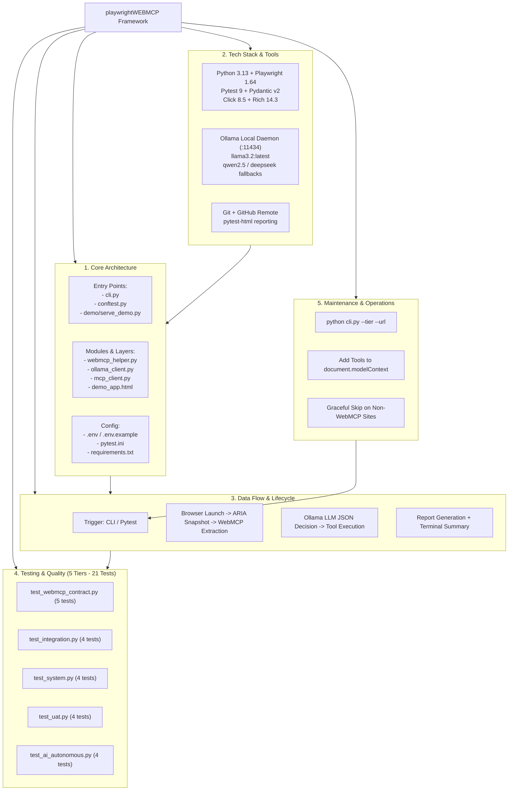

# 🗺️ Project Mindmap: `playwrightWEBMCP`

Comprehensive architectural mindmap and structural breakdown for the **AI Autonomous & Playwright v1.64 WebMCP E2E Testing Framework**.

---

## 1. Mermaid Mindmap Representation

```mermaid
mindmap
  root((playwrightWEBMCP))
    Core Architecture
      Entry Points
        cli.py (Click CLI Runner)
        conftest.py (Pytest Fixtures Engine)
        demo/serve_demo.py (Local HTTP Demo Server)
      Modules and Layers
        utils/webmcp_helper.py (document.modelContext Bridge)
        utils/ollama_client.py (Local AI Inference and Heuristics)
        utils/mcp_client.py (Model Context Protocol Adapter)
        demo/demo_app.html (WebMCP Reference Store)
      Configuration
        .env / .env.example (OLLAMA_URL, TARGET_URL, MODEL)
        pytest.ini (Markers, Asyncio Auto Mode)
        requirements.txt (Strict Dependency Pins)
    Tech Stack and Tools
      Languages and Frameworks
        Python 3.13.5
        Playwright v1.64.0 (Chromium, aria_snapshot)
        Pytest 9.0.3 and pytest-asyncio
        Pydantic v2.13 (Type Schemas and Data Models)
        Click 8.5 (CLI Orchestrator)
        Rich 14.3 (Terminal Formatting)
      AI and Model Storage
        Local Ollama Daemon (:11434)
        llama3.2:latest (Default 2.0GB LLM)
        qwen2.5:latest / deepseek-r1:8b (Fallbacks)
        Zero External API Cost / Offline Inference
      Build and Deployment
        Git and GitHub (goviselenium/playwrightWEBMCP)
        pytest-html (Self-Contained report.html)
        Local File URI and HTTP Hosting
    Data Flow and Lifecycle
      Request and Event Origin
        CLI Command (python cli.py --tier --url)
        Direct Pytest Runner (pytest -m webmcp)
      Processing
        Browser Context Navigation (Playwright)
        document.modelContext Tool Extraction
        YAML ARIA Snapshot Capture
        Ollama JSON Prompt and Tool Resolution
      Persistence and Response
        Pydantic Tool Model Validation
        Live In-Browser Tool Execution
        Formatted Terminal Summary Table
        HTML Test Execution Artifact
    Testing and Quality
      Test Suites (21 Tests)
        test_webmcp_contract.py (WebMCP Spec and Schemas)
        test_integration.py (Network and HTTP 5xx Audits)
        test_system.py (Multi-step UI Locators)
        test_uat.py (Mobile Viewport 375x667 and SLAs)
        test_ai_autonomous.py (Ollama Audits and Agent Tool Calls)
      Quality Assurance
        Graceful Skipping on External Non-WebMCP URLs
        Windows CP1252 Safe UTF-8 Console Encoding
        Strict Marker Enforcement
        Deterministic Temperature 0.1 for LLM Assertions
    Maintenance and Operations
      Logging and Monitoring
        Rich Colored Badges ([PASS] / [FAIL])
        Execution Duration Tracking per Tool
        Browser Console and Error Listeners
      Common Workflows
        Targeting Arbitrary External URLs (--url)
        Adding New WebMCP Tools to Web Pages
        Registering New Test Tiers in pytest.ini and cli.py
        Switching Local AI Models (--model)
```

---

## 2. High-Level Flowchart Architecture Diagram



---

## 3. Structural Breakdown & Component Catalog

### 1. Core Architecture
- **Entry Points**:
  - `cli.py`: Click CLI handler enabling execution against ANY URL across tiers (`webmcp`, `integration`, `system`, `uat`, `autonomous`, `all`).
  - `conftest.py`: Global fixture pipeline instantiating Playwright browser contexts, page lifecycles, and client bindings.
  - `demo/serve_demo.py`: Optional local Python HTTP server hosting `demo_app.html`.
- **Modules & Layers**:
  - `utils/webmcp_helper.py`: Programmatically interfaces with `document.modelContext`, extracts tools, validates JSON schemas against Pydantic models, and executes tools.
  - `utils/ollama_client.py`: Communicates with local Ollama daemon for DOM accessibility evaluation, smart assertions, and autonomous decision-making.
  - `utils/mcp_client.py`: Implements Model Context Protocol structures over browser sessions.
  - `demo/demo_app.html`: Reference implementation with 5 sample tools (`searchCatalog`, `calculateShipping`, `getCurrentCart`, `addToCart`, `submitFeedback`).
- **Configuration**:
  - `.env` / `.env.example`: Environment overrides (`TARGET_URL`, `OLLAMA_BASE_URL`, `DEFAULT_OLLAMA_MODEL`, `OLLAMA_TIMEOUT`).
  - `pytest.ini`: Custom markers, asyncio auto mode, and test discovery paths.

### 2. Tech Stack & Tools
- **Languages & Frameworks**: Python 3.13, Playwright 1.64.0 (Chromium), Pytest 9.0.3, `pytest-asyncio`, Pydantic 2.13, Click 8.5, Rich 14.3.
- **AI & Model Storage**: Local Ollama (v0.35.0), `llama3.2:latest` (2.0GB default), fallback to `qwen2.5:latest` or `deepseek-r1:8b`. Complete privacy, zero external API costs.
- **Build & Deployment**: Git version control, pushed to GitHub repository `goviselenium/playwrightWEBMCP`, `pytest-html` for self-contained visual reports.

### 3. Data Flow & Lifecycle
1. **Trigger**: User runs `python cli.py --url <URL> --tier <TIER> --model <MODEL>`.
2. **Context Setup**: `conftest.py` launches Chromium, configures viewport and user agent, and navigates to the target URL.
3. **Inspection**:
   - WebMCP checks: `document.modelContext` inspected via `page.evaluate()`.
   - AI checks: `page.locator(':root').aria_snapshot()` captures clean YAML accessibility tree.
4. **Autonomous Decision**: Ollama evaluates page state and goals, returning structured JSON tool calls.
5. **Execution & Assertion**: Tool dispatched in browser DOM context; results asserted and rendered.

### 4. Testing & Quality Assurance
- **5 Test Tiers (21 Tests Total, 100% Passing)**:
  - `webmcp` (5 tests): Availability, metadata, tool listing, schema validity, execution.
  - `integration` (4 tests): Network requests, static assets, client API dispatch, console errors.
  - `system` (4 tests): UI title/landmarks, element interaction, dynamic state mutations, forms.
  - `uat` (4 tests): Mobile responsive viewport (375x667), H1 heading baseline, user journeys, latency SLA.
  - `autonomous` (4 tests): Ollama daemon health, accessibility heuristic audit, autonomous tool invocation, semantic assertion.
- **Quality Safeguards**:
  - Graceful skipping on external websites (`pytest.skip()`).
  - UTF-8 stream re-encoding on Windows terminals to prevent CP1252 character map errors.
  - Pydantic schema validation preventing malformed WebMCP definitions.

### 5. Maintenance & Operations
- **Execution Flexibility**: Execute any tier, against any URL, headed or headless, with or without HTML reports.
- **Extensibility**: Add new tools to target web apps by registering in `document.modelContext.tools`.
- **Model Agnostic**: Swap local models seamlessly via `--model "qwen2.5:latest"`.
